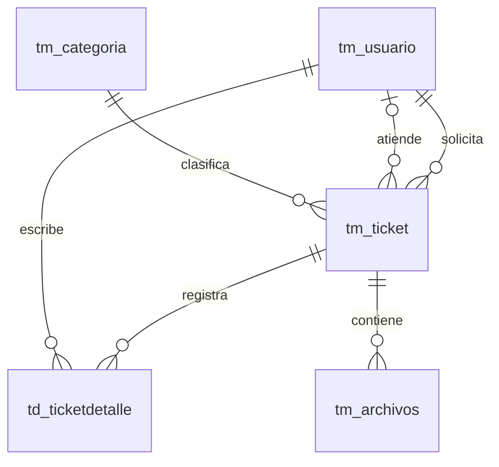
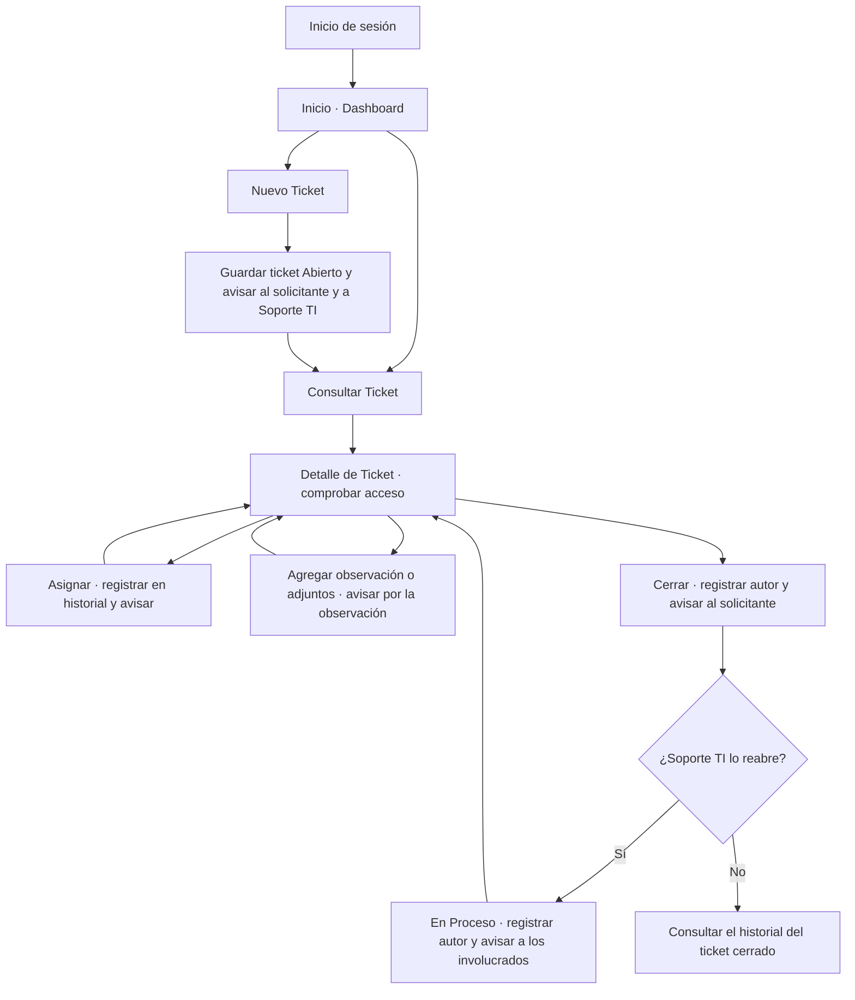

#  DDN Ticket 

**Mesa de ayuda interna de la Defensoría de la Niñez**

Registra requerimientos, organiza la atención de Soporte TI y conserva el historial de cada ticket.

`PHP 8.5` · `Apache` · `MariaDB` · `PHPMailer`

## Tabla de contenidos

1. [Características principales](#características-principales)
2. [Arquitectura y tecnologías](#arquitectura-y-tecnologías)
3. [Instalación y configuración](#instalación-y-configuración)
4. [Conexión a la base de datos](#conexión-a-la-base-de-datos)
5. [Notificaciones y variables de entorno](#notificaciones-y-variables-de-entorno)
6. [Uso, flujo y permisos](#uso-flujo-y-permisos)
   - [Relación entre vistas y flujo del sistema](#relación-entre-vistas-y-flujo-del-sistema)
7. [Operaciones internas](#operaciones-internas)
8. [Adjuntos y respaldo](#adjuntos-y-respaldo)
9. [Pruebas](#pruebas-después-de-restaurar)
10. [Despliegue](#despliegue-institucional)
11. [Mejoras futuras](#mejoras-futuras)
12. [Contribución](#contribución)
13. [Licencia y contacto](#licencia-y-contacto)

![Dashboard de Soporte TI con indicadores de tickets][def]

## Características principales

- Registro, categorización, búsqueda y seguimiento de tickets.
- Asignación a profesionales, observaciones, cierre y reapertura con historial.
- Adjuntos asociados al ticket, vista previa de PDF e imágenes compatibles y descarga con comprobación de acceso.
- Reportes PDF de tickets, usuarios y detalle del ticket.
- Perfil, cambio de contraseña, avatar, dashboard y guía de Ayuda.
- Notificaciones por correo al crear, observar, derivar, cerrar o reabrir un ticket.

## Arquitectura y tecnologías

DDN Ticket usa PHP y PDO en el servidor, MariaDB para los datos y JavaScript, jQuery y DataTables en la interfaz. Los controladores reciben las solicitudes, los modelos consultan o guardan datos y las vistas muestran el resultado.

### Plantilla y componentes de interfaz

DDN Ticket utiliza **StartUI** como plantilla base para la interfaz. El inicio de sesión y las vistas internas cargan sus estilos compartidos. El proyecto adapta la plantilla con la identidad visual de la Defensoría de la Niñez y las pantallas propias de atención de tickets.

**Bootstrap** aporta la cuadrícula y componentes como botones y menús. **DataTables** se usa para los listados y **Summernote** para el editor de los tickets.

### Entorno revisado

| Componente | Versión local |
| --- | --- |
| Apache | 2.4.65 de 64 bits |
| PHP de consola | 8.5.12 de 64 bits, Thread Safe |
| Cliente MariaDB de XAMPP | 10.11.16 |
| PHPMailer | 7.2.0 según composer.lock |

La copia local está en `C:\xampp\htdocs\DDN_TICKET`. La dirección configurada para las redirecciones y los correos es `http://mauricio/ddn_ticket/`.

## Instalación y configuración

### Requisitos previos

- XAMPP en Windows con Apache y MariaDB.
- PHP con `pdo_mysql`, `openssl`, `fileinfo` y `gd`.
- Composer para instalar las dependencias de `composer.lock`.
- Un respaldo SQL de `ddn_ticket` y una copia de los adjuntos para restaurar una instalación existente.

### Restaurar en XAMPP

> **Antes de restaurar:** reúna el respaldo SQL y la copia de los adjuntos. Ambos forman parte de la recuperación.

1. Copie el proyecto completo a `C:\xampp\htdocs\DDN_TICKET`. Conserve `public/document` con los adjuntos y sus archivos de protección, además de `public/img/avatares` si existen avatares.
2. Inicie **Apache** y **MySQL** desde XAMPP. El panel usa el nombre MySQL para el servicio de base de datos.
3. En phpMyAdmin, cree o seleccione la base `ddn_ticket` e importe el respaldo SQL correspondiente a esa copia del proyecto. Verifique que existan `tm_usuario`, `tm_ticket`, `td_ticketdetalle` y `tm_archivos`, incluida la columna `doc_nombre_original`.
4. Revisa en `config/conexion.php` el host, el nombre de la base y las credenciales. Si MariaDB está en el mismo equipo, el host de base de datos puede ser `localhost`. Configura `Conectar::ruta()` con la dirección web que abrirán los usuarios.
5. Si restaura el código sin la carpeta `vendor`, ejecute `composer install` desde la raíz del proyecto. Conserve `composer.lock` para reproducir las versiones instaladas.
6. Compruebe las extensiones PHP `pdo_mysql`, `openssl`, `fileinfo` y `gd`. Composer utiliza `zip` para extraer paquetes cuando no dispone de otra herramienta. Reinicie Apache después de modificar el `php.ini` que usa el servidor.
7. Abra `http://mauricio/ddn_ticket/`. Desde otro equipo de la red de pruebas, ese nombre debe resolver al notebook y Apache debe ser accesible.

## Conexión a la base de datos

DDN Ticket usa **PDO con el controlador `pdo_mysql`** para conectarse a la base `ddn_ticket`. La configuración está en [config/conexion.php](config/conexion.php).

| Parámetro | En XAMPP | Qué debe revisar al trasladarlo |
| --- | --- | --- |
| Host de base de datos | `localhost` | Mantenga este valor si MariaDB corre en el mismo equipo que PHP. Si corre en otro servidor, usa su nombre o IP. |
| Base de datos | `ddn_ticket` | Debe coincidir con el nombre de la base donde importaste el respaldo. |
| Usuario y contraseña | Los configurados en MariaDB | Usa una cuenta de la aplicación con acceso a esta base y conserva sus credenciales fuera del repositorio. |
| Puerto | El predeterminado del controlador | Si configuraste otro puerto, agrégalo a la cadena de conexión, por ejemplo `port=3307`. |
| Dirección web | `http://mauricio/ddn_ticket/` | Se define en `Conectar::ruta()` para enlaces y redirecciones. |

Ejemplo de conexión para adaptar dentro de `Conexion()`. Las variables de usuario y contraseña representan las credenciales de la aplicación.

```php
$dsn = "mysql:host=localhost;port=3306;dbname=ddn_ticket;charset=utf8mb4";
$conexion = new PDO($dsn, $usuarioBD, $claveBD, [
    PDO::ATTR_ERRMODE => PDO::ERRMODE_EXCEPTION,
]);
```

1. Inicie **MySQL** desde el panel de XAMPP y abra phpMyAdmin.
2. Seleccione `ddn_ticket` y compruebe que estén las tablas de usuarios, tickets, observaciones y adjuntos.
3. Confirme que PHP carga el controlador con `C:\xampp\php\php.exe --ri pdo_mysql`.
4. Abra DDN Ticket e inicie sesión con una cuenta de prueba. Consulta un ticket existente para comprobar que la aplicación puede leer la base.

| Mensaje | Qué revisar |
| --- | --- |
| `could not find driver` | Habilita `pdo_mysql` en el `php.ini` que usa Apache y reinicia Apache. |
| `Connection refused` | Verifica que MariaDB esté iniciado y confirma el host y el puerto. |
| `Access denied` | Comprueba las credenciales y los permisos de la cuenta. |
| `Unknown database` | Revisa el nombre de la base y si se importó el respaldo. |
| `Table ... doesn't exist` | Verifica que el respaldo incluya la tabla y que se haya importado en la base elegida. |

### Administración con phpMyAdmin

**MariaDB** almacena los datos y **phpMyAdmin** permite administrarlos desde el navegador. Con Apache y MySQL iniciados en XAMPP, abre [phpMyAdmin en el equipo servidor](http://localhost/phpmyadmin/). Para restaurar, selecciona `ddn_ticket`, abre **Importar**, elige `ddn_ticket.sql` y usa el formato **SQL**.

El respaldo revisado contiene estructura y datos. Guárdalo fuera de `htdocs` antes de habilitar el acceso desde otros equipos. Los archivos adjuntos y avatares se respaldan por separado.

### Tablas y campos

| Tabla | Clave primaria | Campos y finalidad |
| --- | --- | --- |
| `tm_usuario` | `usu_id` | `usu_nombre`, `usu_paterno`, `usu_materno` y `usu_correo` identifican la cuenta. `usu_pass` guarda el hash de contraseña. `rol_id` define el rol y `est` indica si la cuenta está activa. Incluye fechas de creación, modificación y eliminación. |
| `tm_categoria` | `cat_id` | `cat_nom` guarda el nombre de la categoría y `est` su vigencia. |
| `tm_ticket` | `tick_id` | `usu_id` identifica al solicitante, `cat_id` la categoría y `usu_asig` al profesional asignado si lo hay. `tick_titulo`, `tick_descrip`, `tick_estado`, `fech_crea`, `fech_asig` y `est` completan el registro. |
| `td_ticketdetalle` | `tickd_id` | `tick_id` identifica el ticket y `usu_id` al autor. `tickd_descrip`, `fech_crea` y `est` registran observaciones y eventos del historial. |
| `tm_archivos` | `doc_id` | `tick_id` identifica el ticket. `doc_nom` es el nombre en disco, `doc_nombre_original` el nombre mostrado o descargado, y `doc_fecha` y `doc_est` registran la fecha y vigencia. |
| `td_archivos` | `doc_id` | Tabla presente en el respaldo con `tick_id`, `doc_nom`, `doc_fech` y `doc_est`. El flujo de adjuntos revisado usa `tm_archivos`. |

### Relaciones entre tablas

Un ticket tiene un solicitante y una categoría. Puede tener un profesional asignado y varios registros de historial y adjuntos. El respaldo define claves primarias. Las asociaciones siguientes se representan como **relaciones lógicas del código**, ya que el SQL revisado carece de restricciones `FOREIGN KEY`.



## Uso, flujo y permisos

1. El solicitante crea el ticket, recibe su número y lo encuentra en **Consultar Ticket**. Las tarjetas del dashboard abren el listado filtrado por estado.
2. Soporte TI revisa y asigna el ticket. El solicitante y el profesional asignado reciben sus avisos de derivación.
3. Las observaciones y los adjuntos se agregan desde el detalle. El historial muestra el autor y el momento de cada operación.
4. Tras cerrar un ticket, el historial sigue disponible. Soporte TI puede reabrirlo y devolverlo a **En Proceso**. La reapertura queda registrada con su autor.

| Cuenta | Tickets que puede consultar |
| --- | --- |
| Soporte TI (rol 2, ID configurado en `models/Ticket.php`) | Todos los tickets activos. Puede reabrir tickets cerrados. |
| Otros usuarios de rol 2 | Los que crearon o tienen asignados. |
| Usuarios de rol 1 | Los que crearon. |

## Adjuntos y respaldo

- Los nuevos archivos se guardan en `public/document/<ID del ticket>/`. Los adjuntos antiguos pueden seguir en la carpeta raíz de `document`.
- El modelo conserva el nombre original para mostrarlo y descargarlo. En disco se usa un identificador único para evitar que dos adjuntos con el mismo nombre se sobrescriban.
- El controlador limita cada archivo a **10 MB**. Los valores `upload_max_filesize` y `post_max_size` de PHP también afectan la carga, y este último se aplica al envío completo.
- Incluye en el respaldo el SQL, la carpeta de adjuntos con sus reglas de acceso y los avatares. Comprueba la restauración descargando un adjunto previo desde una cuenta autorizada.

## Notificaciones y variables de entorno

> **Remitente institucional:** Soporte TI · Microsoft 365 · STARTTLS

`models/Email.php` usa PHPMailer para enviar mediante SMTP de Microsoft 365. El remitente es `soporte.ti@defensorianinez.cl`, el servidor es `smtp.office365.com` y el puerto es **587 con STARTTLS**.

- `DDN_SMTP_PASSWORD` contiene la contraseña en el entorno donde se ejecuta PHP. Configúrala fuera del repositorio y reinicia Apache desde un proceso que tenga acceso a esa variable.
- `DDN_TICKET_URL` permite definir la dirección base de los enlaces enviados por correo. Usa la dirección que los destinatarios puedan abrir.
- Los avisos contienen el evento, el número del ticket y el enlace al sistema. El detalle y los adjuntos se consultan dentro del ticket.
- Una falla de correo se registra por separado de la operación del ticket. Verifica la autenticación SMTP y la recepción con una cuenta de prueba.

## Estructura

| Ubicación | Responsabilidad |
| --- | --- |
| `index.php`, `index.js` | Inicio de sesión |
| `config/` | Conexión a la base de datos y dirección del sistema |
| `controller/` | Operaciones de tickets, archivos, usuarios y perfil |
| `models/` | Acceso a datos y envío de avisos |
| `view/` | Dashboard, Nuevo Ticket, Consultar Ticket, Detalle de Ticket, Perfil y Ayuda |
| `public/document/` | Archivos asociados a tickets, incluidos los que se guardan en carpetas por ID |
| `public/img/avatares/` | Imágenes de perfil |
| `docs/` | Documentación y capturas del proyecto |

La cuenta **Soporte TI** tiene acceso global a los tickets activos. Los demás usuarios de rol 2 consultan los que crearon o tienen asignados. Los usuarios de rol 1 consultan sus propios tickets.

## Relación entre vistas y flujo del sistema

| Vista | Cómo se conecta con las demás |
| --- | --- |
| `index.php` | Inicio de sesión. Al ingresar correctamente, abre `view/Home/`. |
| `view/Home/` | Dashboard. Las tarjetas abren **Consultar Ticket** con el estado seleccionado. |
| `view/NuevoTicket/` | Registra el requerimiento y devuelve su número. El ticket queda disponible en **Consultar Ticket**. |
| `view/ConsultarTicket/` | Lista y búsqueda de tickets autorizados. **Ver** abre **Detalle de Ticket**. |
| `view/DetalleTicket/` | Muestra historial, adjuntos y acciones según permisos. Permite descargar el PDF del detalle. |
| `view/MntPerfil/`, `view/Ayuda/` | Se abren desde el menú del avatar. |
| `view/MntUsuario/` | Mantenedor de usuarios para las cuentas autorizadas. |



## Operaciones internas

La aplicación usa controladores PHP y la sesión de DDN Ticket. Los controladores comprueban los permisos según la operación.

| Método | Ruta relativa a la raíz | Operación |
| --- | --- | --- |
| POST | `controller/ticket.php?op=insert` | Crear un ticket. |
| POST | `controller/ticket.php?op=listar_x_usu` | Consultar los tickets visibles para la cuenta. |
| POST | `controller/ticket.php?op=insertdetalle` | Agregar una observación. |
| POST | `controller/ticket.php?op=asignar` | Derivar un ticket. |
| POST | `controller/ticket.php?op=reabrir` | Reabrir un ticket cerrado con la cuenta Soporte TI. |
| GET | `controller/archivos.php?op=ver` | Abrir la vista previa de un adjunto autorizado. |
| GET | `controller/archivos.php?op=descargar` | Descargar un adjunto autorizado. |

## Pruebas después de restaurar

- [ ] Iniciar sesión y revisar el dashboard y los filtros por estado.
- [ ] Crear un ticket con un adjunto, derivarlo con una observación y descargar el archivo desde una cuenta autorizada.
- [ ] Verificar que una cuenta ajena al ticket no pueda abrir su detalle ni descargar sus adjuntos.
- [ ] Cerrar y reabrir un ticket de prueba. Revisar el autor, el historial y la recepción de los avisos correspondientes.
- [ ] Descargar el PDF de un detalle con observaciones e imágenes.
- [ ] Cambiar datos del perfil y guardar un avatar.

## Despliegue institucional

Actualiza `Conectar::ruta()` y `DDN_TICKET_URL` cuando el sitio, el DNS y el certificado HTTPS estén operativos. Mantén el respaldo SQL junto con la copia de los adjuntos en una ubicación fuera del directorio público.

## Mejoras futuras

| Mejora | Alcance previsto |
| --- | --- |
| **Subcategorías** | Clasificar con más precisión los tickets. Por ejemplo, dentro de **Hardware**, distinguir impresoras, notebooks y periféricos. |
| **Manuales de usuario** | Preparar guías con capturas para solicitantes y Soporte TI. Publicarlas en **Ayuda** y actualizarlas cuando cambien los procesos. |
| **Inventario de activos TI** | Crear una vista para registrar equipos, número de serie, ubicación, responsable y estado. Permitir vincular un activo a un ticket para consultar su historial de fallas. |
| **Importación desde Excel** | Incorporar una plantilla para cargar usuarios y, más adelante, activos. Mostrar una vista previa, detectar duplicados y devolver errores por fila antes de confirmar la importación. |
| **Indicadores de gestión (KPI)** | Ampliar el dashboard con tiempos de primera respuesta y resolución, tickets pendientes por antigüedad y tasa de reapertura. Definir cómo se calcula cada indicador y qué periodo abarca. |
| **Acuerdos de nivel de servicio (SLA)** | Definir metas de respuesta y resolución por prioridad, con horario hábil y condiciones de pausa. Mostrar vencimientos próximos y calcular el porcentaje de tickets atendidos dentro de la meta. |

Estas mejoras están previstas para etapas posteriores. Los KPI de tiempo proporcionarán la base para medir el cumplimiento de los SLA.

## Contribución

Trabaja en una rama de Git y prueba los cambios en XAMPP antes de incorporarlos. Si cambias la estructura de la base, documenta cómo aplicar y verificar la modificación. Mantén las credenciales, respaldos con datos reales y adjuntos de usuarios fuera de los commits.

## Licencia y contacto

Licencia del proyecto pendiente de confirmar. Las dependencias mantienen sus propias licencias.

**Mauricio Mora Vergara** · m.moravergara@uandresbello.edu


[def]: ./DashBoard.png
